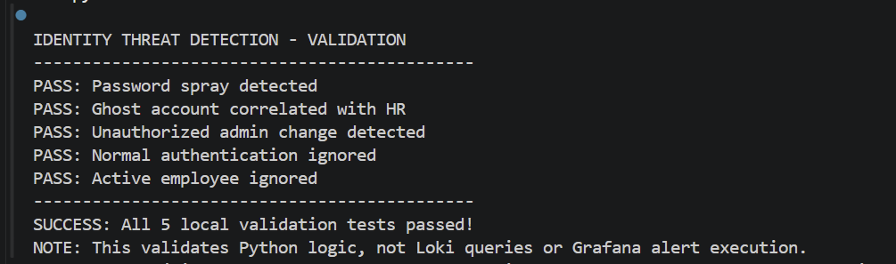
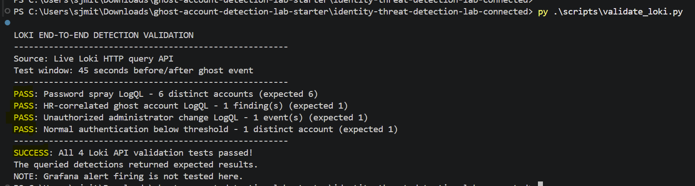
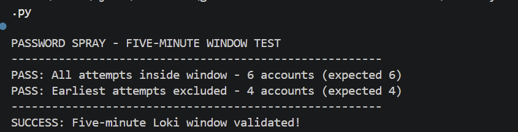
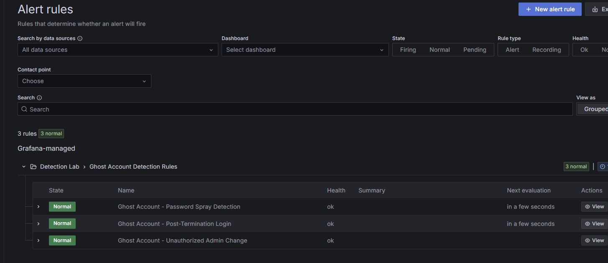
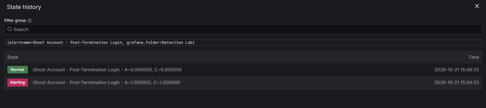
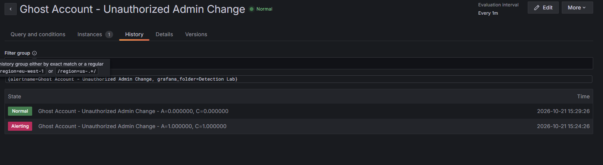

# The Ghost Account: Identity Threat Detection Lab

### The Employee Left. Their Access Didn't.

**Detecting password spraying, suspicious terminated-account authentication, and unauthorized privilege changes using Python, Grafana Loki, and LogQL.**

**Technologies:** Python 3 | OrangeHRM | Authentik | Grafana Loki | LogQL | Grafana

**Status:** Detection scenarios validated in a controlled lab — October 2026

---

## 1. The Problem — When Identity Controls Fail, Who Detects It?

Terminating an employee should trigger the immediate removal of access to corporate systems. However, compromised credentials, stale permissions, lingering sessions, and unauthorized privilege changes can expose organizations to continued identity-based threats.

Security teams need to detect three particularly concerning behaviors:

- **Password spraying:** Repeated authentication failures across multiple user accounts from a common source.
- **Terminated-account authentication:** Successful login activity associated with an identity that should no longer have access.
- **Unauthorized privilege escalation:** Elevated permissions granted without appropriate approval.

**Business Impact:** Without effective identity threat monitoring, unauthorized access attempts and privilege changes may remain undetected, increasing the risk of account compromise, data exposure, and lateral movement.

**The challenge:** Build a detection pipeline capable of identifying suspicious authentication patterns, distinguishing threats from ordinary login failures, and automatically alerting defenders when suspicious activity exceeds defined thresholds.

## 2. The Solution — An Identity Threat Detection Pipeline

I developed an identity threat detection workflow using Python, separate HR termination reference data, Grafana Loki, LogQL, and Grafana. The lab includes three Grafana-managed automated alert rules, alongside saved manual investigation queries.

The solution delivers:

1. **Centralized security event ingestion** for structured authentication and privileged-access logs.
2. **Three detection queries** identifying password spraying, terminated-account login events, and unauthorized administrator assignments.
3. **A centralized Grafana dashboard** for investigating suspicious activity.
4. **Three Grafana-managed automated alerts** for password spraying, HR-correlated post-termination logins, and simulated unauthorized administrator changes.
5. **Layered validation:** five local Python checks, four Loki API checks, two rolling-window boundary checks, and recorded alert firing/recovery states.

The implementation combines IAM lifecycle context with security monitoring to demonstrate how identity risks can be identified through event analysis and automated detection.

## 3. How I Implemented the Solution

| Phase | Engineering Work |
|---|---|
| Identity Verification | Verified Billy Kaplan's termination record in OrangeHRM and inactive identity in Authentik |
| Event Generation | Generated 10 synthetic authentication and access-change events, then correlated independent HR termination data to produce 1 additional security finding (11 records total) |
| Log Ingestion | Submitted structured JSON events through Loki's HTTP ingestion API |
| Detection Logic | Developed LogQL queries targeting three identity threat patterns |
| Security Monitoring | Created a three-panel Grafana investigation dashboard |
| Automated Alerting | Configured three Grafana-managed alert rules; evaluated every minute in the Detection Lab |
| Validation | Passed 5 local Python tests, 4 Loki API tests, and 2 rolling-window boundary checks; captured alert firing/recovery history |


### Security Detection Pipeline Architecture


**Architecture notes:** OrangeHRM and Authentik were manually inspected for identity context; neither is directly integrated with this synthetic event pipeline. A separate HR termination CSV is correlated with synthetic authentication events in Python. Each full simulation batch generates 10 source events and one derived ghost-account finding (11 Loki records). Separate controlled events were later sent to verify individual alert firing. All three detection scenarios have Grafana-managed alert rules; the two newer rules use a contact point with no notification integrations.

## 4. Results — What the Solution Detected

A full simulation batch produced 10 synthetic source events and one HR-correlated finding, accepted by Loki with HTTP 204. The saved LogQL queries returned expected results through the Loki API. Three Grafana-managed rules were configured; alert firing and recovery were observed in controlled lab tests. Separate alert tests sent additional synthetic records after the original full batch.

| Detection / Validation | Verified Result |
|---|---|
| Password spraying | 6 distinct accounts targeted from one source IP |
| Normal failed authentication | 1 account from a separate IP, below the threshold |
| Terminated-account authentication | 1 correlated ghost-account finding from a separate HR CSV and a synthetic successful-login event |
| Unauthorized privilege escalation | 1 matching synthetic administrator-group addition |
| Python validation | 5 of 5 local Python validation checks passed |
| Live Loki API validation | 4 of 4 checks passed using `scripts/validate_loki.py` |
| Loki API results | 6 password-spray accounts, 1 HR-correlated ghost-account finding, 1 unauthorized admin change, and normal activity below threshold |
| Loki API evidence | [View screenshot](evidence/screenshots/06-loki-api-validation.png) |
| Five-minute boundary test | 2 of 2 Loki time-window checks passed (6 accounts counted, then 4 after earlier attempts aged out) |
| Loki ingestion | HTTP 204 |
| Loki records accepted per full batch | 11 records (10 source events + 1 HR-correlated finding) |
| Detection queries | 3 successfully tested |
| Grafana monitoring | 3 working investigation panels |
| Automated alert coverage | 3 Grafana-managed rules; password spray previously validated and the newer ghost-account/admin-change rules verified firing and recovery |

### Security Detection Dashboard

I developed a three-panel Grafana dashboard to provide visibility into authentication failures, terminated-account login activity, and unauthorized privileged-group changes.


**Key Outcome:** Loki detected six distinct usernames targeted over 150 seconds from one simulated source IP, distinguished isolated normal failures, and returned the expected results for the identity and privilege-change scenarios. All three scenarios have automated Grafana rules.

The terminated-account and privilege-change detections began as manual LogQL hunts and were later configured as automated rules. Controlled synthetic events verified that both new rules entered Alerting and returned to Normal. The saved queries remain useful for manual investigations.

## 5. Security Investigation — The Ghost Account

### Stage 1 — Employee Termination

Billy Kaplan's HR record documented termination on October 10, 2026.

An identity review confirmed that his corresponding Authentik account, `billy.kaplan`, was inactive.

This established the expected access-control baseline: a terminated identity should not have active system access.

### Stage 2 — Simulated Password Spraying

A controlled simulation generated failed authentication attempts against six different user accounts, spaced 30 seconds apart over 150 seconds, from the documentation-only source IP:

`203.0.113.25`

The dataset also included one ordinary failed-login event from another source IP.

This created both a suspicious authentication pattern and a normal-activity comparison for validation.

### Stage 3 — Suspicious Terminated-Account Authentication

A synthetic authentication event recorded a successful login for `billy.kaplan` **without** an employment-status field. Python separately read `data/terminated_users.csv`, matched the username, compared login and termination dates, and generated a `ghost_account_finding` that was ingested into Loki. The CSV is a lab fixture, not a live OrangeHRM feed.

This represented a hypothetical access-control failure requiring security investigation.

### Stage 4 — Unauthorized Privilege Change

A subsequent synthetic event recorded an unapproved addition of `billy.kaplan` to the Administrators group.

This modeled a potential privilege escalation following suspicious authentication activity.

### Stage 5 — Detection and Investigation

The synthetic security events were ingested into Loki and investigated using LogQL.

Grafana returned matching records for all three suspicious behaviors.

Grafana alerts were configured for all three scenarios. The password-spray alert was previously validated; controlled test events also caused the post-termination and administrator-change rules to enter Alerting/Firing and then return to Normal.

**Investigation scope:** The suspicious authentication and privilege-change events were simulated. They were not actual actions performed against Billy's inactive Authentik account.

## 6. Detection Engineering — LogQL Implementation

### Detection 1 — Password Spraying

**Objective:** Identify multiple distinct accounts experiencing failed authentication from a common source IP within five minutes.

```logql
count by (source_ip) (
  sum by (source_ip, username) (
    count_over_time(
      {job="identity_detection_lab", scenario="billy_kaplan"}
      | json
      | event_type="login"
      | status="failed"
      [5m]
    ) > bool 0
  )
)
```

**Observed Result:**

- Suspicious IP: `203.0.113.25`
- Distinct accounts targeted: 6
- Detection window: 5 minutes
- Automated alert threshold: Greater than 4
- Result: Detection condition satisfied

The query counts distinct usernames rather than simply counting failed authentication events, helping distinguish a password-spray pattern from repeated attempts against a single account.

### Password-Spray Timing and Window Validation

**Objective:** Verify that password-spray detection correctly evaluates distinct usernames within a rolling five-minute window.

**Implementation:** Generated six synthetic failed authentication attempts from one documentation-only source IP, targeting six different accounts at 30-second intervals over 150 seconds.

**Loki API Validation Results:**

| Test | Expected | Observed | Result |
|---|---|---|---|
| All attempts within five minutes | 6 accounts | 6 accounts | PASS |
| Advance window to exclude earliest attempts | 4 accounts | 4 accounts | PASS |

The tests executed LogQL against Loki using historical evaluation timestamps, demonstrating that earlier attempts expire from the rolling window.

**Validation Script:** `scripts/validate_spray_window.py`

**Evidence:**
- [Realistic Spray Detection Validation](evidence/screenshots/07-realistic-spray-validation.png)
- [Five-Minute Boundary Test](evidence/screenshots/08-spray-window-boundary-test.png)

**Scope:** These tests validate Loki query results and window boundaries. Alert execution is documented separately in Section 7; production false-positive rates have not been measured.

---

### Detection 2 — HR-Correlated Ghost Account Detection

**Objective:** Identify successful authentication events associated with terminated employees by correlating two separate data sources.

**Problem:** Authentication logs do not normally contain an employee's HR termination status. Relying on a prepopulated `employment_status` field would not demonstrate real correlation.

**Solution:** Developed a Python correlation process that independently reads HR termination reference data from `data/terminated_users.csv` and synthetic authentication events generated by `send_simulated_events.py`.

The correlation logic:

1. Loads terminated employee records from the HR reference file.
2. Matches authentication usernames against the terminated identities.
3. Compares successful login dates with termination dates.
4. Generates a `ghost_account_finding` when successful authentication occurs after termination.
5. Sends the enriched security finding to Grafana Loki for investigation.

**LogQL Investigation Query:**

```logql
{job="identity_detection_lab", scenario="billy_kaplan"}
| json
| event_type="ghost_account_finding"
```

**Verified Results:**

- 1 HR-correlated ghost-account finding generated for `billy.kaplan`.
- 3 correlation tests passed, including two negative scenarios.
- 10 synthetic source events plus 1 derived finding accepted by Loki in a full batch (HTTP 204).
- 1 matching ghost-account finding retrieved in Grafana Explore.

**Security Significance:** Demonstrates cross-source identity correlation without embedding HR employment status in the original authentication event.

**Scope:** The HR reference file and authentication events are lab data. The correlation logic was executed and its finding retrieved from Loki; live HR and identity-provider log integration was not implemented.

### Detection 3 — Unauthorized Privilege Escalation

**Objective:** Detect unapproved membership additions to the Administrators group.

```logql
{job="identity_detection_lab", scenario="billy_kaplan"}
| json
| event_type="group_membership_added"
| target_group="Administrators"
| approved="no"
```

**Observed Result:** One synthetic administrator-group membership addition associated with `billy.kaplan`, marked `approved="no"`. The derived five-minute alert rule was subsequently tested with a single controlled event.

The `approved="no"` value was supplied by the synthetic event generator; production detection would require verification against authoritative access-request or change-management records.

## 7. Automated Alerting and Validation

I configured **three Grafana-managed alert rules** in **Detection Lab → Ghost Account Detection Rules**, with a one-minute evaluation interval. Saved LogQL queries also remain available for manual investigation.

### Alert Configuration and Observed Outcomes

| Automated rule | Trigger | Lab outcome |
|---|---|---|
| Ghost Account - Password Spray Detection | More than four distinct usernames failing from one source IP within five minutes | Previously observed in Alerting/Firing with six simulated accounts |
| Ghost Account - Post-Termination Login | One or more `ghost_account_finding` records in five minutes | Entered Alerting with one finding and returned to Normal after the window expired |
| Ghost Account - Unauthorized Admin Change | One or more simulated unapproved Administrators additions in five minutes | Entered Alerting with one event and returned to Normal after the window expired |

The post-termination and administrator-change rules used a **0-second pending period** and a **one-minute evaluation interval**. They were tested with separate, narrowly scoped synthetic event submissions rather than replaying the full 11-record scenario. Their contact point, **Detection Lab - No Notifications**, had no notification integrations. External notification delivery was not tested.

### Numeric Alert Queries

The two additional rules use numeric LogQL expressions so Grafana can evaluate alert thresholds. Example — HR-correlated ghost-account finding:

```logql
sum(
  count_over_time(
    {job="identity_detection_lab", scenario="billy_kaplan"}
    | json
    | event_type="ghost_account_finding"
    [5m]
  )
) or on() vector(0)
```

The administrator-change rule uses the same aggregation pattern but filters for `event_type="group_membership_added"`, `target_group="Administrators"`, and `approved="no"`. Both rules fire when the query value is **above 0**.

### Verified Alert Evidence

| Evidence | Screenshot |
|---|---|
| Password-spray alert history (original test) | [View](evidence/screenshots/10-billy-alert-history.png) |
| All three alert rules configured | [View](evidence/screenshots/12-three-automated-alerts.png) |
| Ghost-account alert in Firing state | [View](evidence/screenshots/10-ghost-account-alert-firing.png) |
| Ghost-account alert history: Alerting → Normal | [View](evidence/screenshots/11-ghost-account-alert-history.png) |
| Unauthorized administrator alert in Firing state | [View](evidence/screenshots/13-admin-change-alert-firing.png) |
| Unauthorized administrator alert history: Alerting → Normal | [View](evidence/screenshots/14-admin-change-alert-history.png) |

**Validation boundary:** These observations establish alert evaluation and state changes in the Grafana lab. They do not establish production false-positive performance, actual privilege changes in Authentik, or successful external notification delivery.

## 8. Technical Challenges and Lessons Learned

### Challenge 1 — Grafana Data Source Connectivity

During implementation, Grafana initially failed to query Loki because of a data source connection configuration issue.

I troubleshot the issue by separating ingestion verification from Grafana's query connection, checking Loki readiness, and confirming that event submission returned HTTP 204.

After establishing a working Grafana data source, the synthetic logs were successfully retrieved and analyzed.

**Lesson learned:** Successful log ingestion does not guarantee successful querying or alerting. Each stage of the monitoring pipeline must be validated independently.

### Challenge 2 — Differentiating Suspicious Activity From Normal Authentication Failures

A single failed login does not necessarily indicate an attack.

The password-spray detection used distinct-account aggregation to identify multiple accounts targeted by a common source IP within a defined time window.

**Lesson learned:** Effective detection engineering depends on meaningful aggregation, time windows, and thresholds—not just raw event counts.

### Challenge 3 — Validating Automated Alerts

A working LogQL query does not prove that an automated alert will trigger.

I configured the evaluation interval, threshold, pending period, and alert state handling, then generated fresh synthetic events to validate execution.

**Lesson learned:** Alert state history provides important evidence that detection rules are evaluated and can trigger under expected conditions.

### Challenge 4 — Connecting IAM With Security Detection

The HR termination record and inactive Authentik account established the expected identity lifecycle state.

The simulated security events demonstrated how a defender might investigate activity inconsistent with that state.

**Lesson learned:** Identity lifecycle context can strengthen authentication and privilege-change investigations.

## 9. Project Evidence

### Identity Lifecycle Verification

**Employee termination — OrangeHRM**


**Inactive identity — Authentik**


### Security Event Generation and Detection

**Original local validation baseline (historical screenshot)**


**Updated local validation — Five passing checks**



**Live Loki API validation — Four passing checks**



**Rolling five-minute window test — Six included, then four**



**Synthetic events collected in Loki**


**Grafana investigation dashboard**


**Original password-spray alert history**


**All three automated alert rules**



**Post-termination alert history**



**Unauthorized administrator alert history**



## 10. Reproducing the Detection Simulation

### Requirements

- Python 3
- Authorized Grafana Loki environment with working HTTP ingestion/query endpoints
- Grafana configured with the Loki data source
- Synthetic HR reference data in `data/terminated_users.csv` (the lab fixture, not a live HR integration)

### Generate Synthetic Events

```powershell
py scripts/send_simulated_events.py --dry-run
```

### Validate Detection Conditions Locally

```powershell
py scripts/correlate_identity_events.py
py scripts/validate_detection.py
```

These checks exercise the Python correlation and detection logic; they do **not** query Loki.

### Configure a Loki Ingestion Endpoint

```powershell
$env:LOKI_PUSH_URL = "http://YOUR-LOKI-HOST:PORT/loki/api/v1/push"
```

### Submit Synthetic Security Events

```powershell
py scripts/send_simulated_events.py --send
```

### Query Loki and Validate the Rolling Window

After ingestion, and with `LOKI_PUSH_URL` still configured in the terminal:

```powershell
py scripts/validate_loki.py
py scripts/validate_spray_window.py
```

These scripts query the Loki HTTP API. The scenario must have been ingested recently enough for the live validation script's lookback window; the boundary test uses recorded event timestamps.

### Investigate Security Events

In Grafana Explore, run:

```logql
{job="identity_detection_lab", scenario="billy_kaplan"} | json
```

The `queries/` directory contains saved LogQL investigation queries and an administrator-change alert-query draft. Three Grafana-managed alert rules were also configured interactively and tested in the lab.

### Controlled Alert-Test Scripts

Run dry-run previews before any test submission:

```powershell
py scripts/send_ghost_alert_test.py --dry-run
py scripts/send_admin_alert_test.py --dry-run
```

The `--send` option requires an explicitly configured instructor-authorized Loki push endpoint and submits synthetic events. The controlled tests were used to verify Grafana alert firing/recovery. These scripts do **not** perform authentication or change account permissions.

## 11. Future Improvements

**Production-tuning considerations (not implemented or measured in this lab):** A source IP can represent many legitimate users behind a corporate VPN, NAT gateway, proxy, or load balancer. Five distinct login failures over five minutes is a useful lab threshold, **not a validated production threshold**. In production, I would baseline normal per-IP and per-user failure patterns, tune by source category and expected login volume, correlate device/user/session context, and investigate exceptions before suppressing alerts. Similar care is needed to validate real HR termination feeds and change approvals.

Further improvements include:

- Correlating authoritative HR lifecycle events with live identity-provider authentication data.
- Exporting or provisioning all three Grafana alert rules as version-controlled configuration to improve reproducibility.
- Developing Sigma rules for portable security detection logic.
- Baseline-tuning password-spray thresholds by source category (corporate VPN, NAT egress, proxy, and service accounts), considering allowlisting only well-understood benign sources and retaining monitoring for misuse.
- Introducing alert severity classifications and incident response playbooks.
- Expanding validation coverage to include duplicate events, benign shared-IP login bursts, service-account failures, ingestion gaps, and realistic false-positive tests.

## 12. Security and Testing Scope

This project used controlled synthetic security events and documentation-only IP addresses. The initial full batch comprised 10 generated source events plus 1 derived ghost-account finding; later focused submissions tested individual alerts.

Billy Kaplan's termination and inactive Authentik status were independently verified as identity lifecycle context. The suspicious login, password-spray activity, and privileged-group change were simulated using Python.

No actual unauthorized login, account compromise, privilege escalation, or real password-spray attack was performed. The separate HR CSV was a lab reference file, not a live OrangeHRM export or automated provider connection.

Credentials and private infrastructure details are not required to reproduce the code. Alert state testing occurred in a controlled Grafana/Loki lab; external notification delivery was not tested.

## 13. Project Outcome

**Built and validated a controlled identity-threat detection workflow using Python, separate HR reference data, Grafana Loki, LogQL, and Grafana.**

The implementation demonstrates hands-on experience in security event generation, cross-source HR/authentication correlation, centralized log ingestion, LogQL detection engineering, security investigations, three Grafana-managed alert rules, troubleshooting, and layered validation.

The lab demonstrates how identity lifecycle context can strengthen event-based detections while keeping simulated activity, manually verified identity context, and production integration boundaries explicit.
