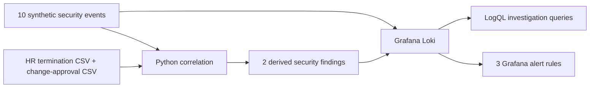
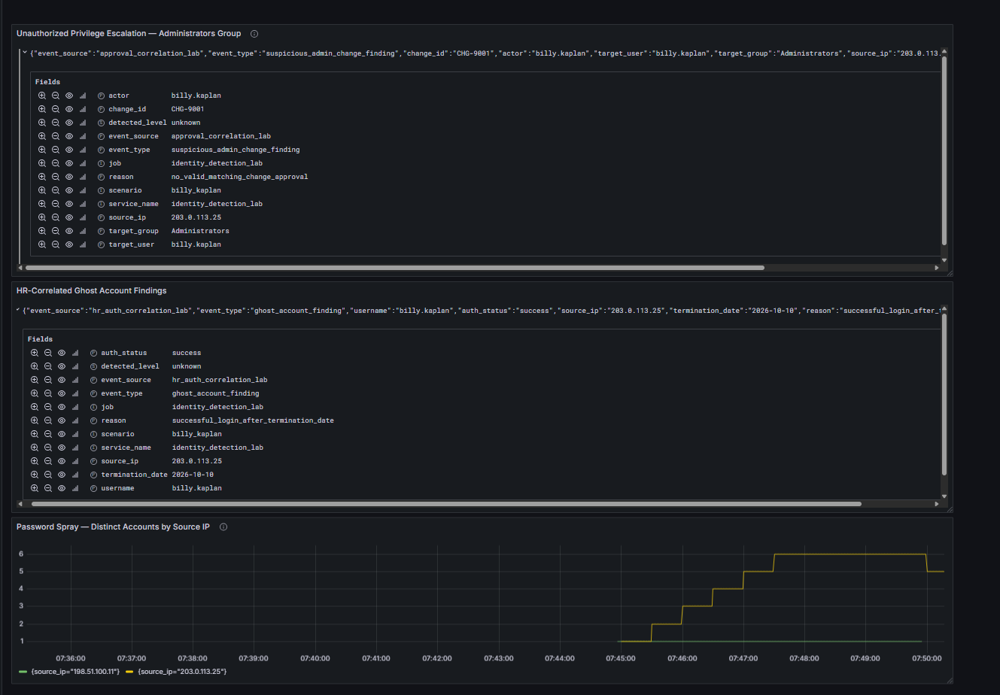

# The Ghost Account — Identity Threat Detection Lab


**The employee left. Their access didn't.**

I built a controlled identity-threat detection pipeline to investigate **password spraying**, **successful authentication after employee termination**, and **administrator-group changes without valid approval**.

**Stack:** Python 3 · Grafana Loki · LogQL · Grafana · synthetic HR and change-approval CSVs  
**Artifacts:** [Detection queries](queries/) · [Exported Grafana alert rules](alerts/ghost-account-rules.yaml) · [Python scripts](scripts/) · [GitHub Actions tests](.github/workflows/detection-tests.yml)

## The problem

Identity-related threats can cross the boundary between HR records, identity controls, authentication logs, and IT change approvals. Looking at an individual login or group-change event alone can miss the larger story. I wanted to detect suspicious patterns while distinguishing them from normal authentication failures and explicitly checking whether a privileged change was authorized.

## The solution

The lab generates **10 synthetic source events** and correlates them in Python with **two separate reference datasets**: terminated employees and administrator-change approvals. The correlation scripts create **two derived findings**, giving **12 Loki records per full batch**. Loki stores the events and findings; LogQL queries and **three Grafana-managed alerts** surface the scenarios.

The synthetic case centers on `billy.kaplan`: his termination and inactive account were manually checked in OrangeHRM and Authentik; a simulated successful login after termination and an administrator-group addition were then investigated. The original authentication and group-change events do **not** get to declare their own HR or approval verdicts.



## The three detections

### 1. Password spraying — distinct accounts, five-minute window

This query groups failed logins by source IP and counts the **distinct usernames** affected, rather than treating repeated failures for one account as a spray. The lab alert triggers when the result is **greater than four**.

```logql
count by (source_ip) (
  sum by (source_ip, username) (
    count_over_time(
      {job="identity_detection_lab", scenario="billy_kaplan"}
      | json
      | event_type="login"
      | status="failed"
      [5m]
    ) > bool 0
  )
)
```

**Observed:** Six distinct accounts failed authentication from `203.0.113.25` over 150 seconds. A separate isolated failed login stayed below the threshold. A rolling-window test returned six accounts initially and four after earlier events aged out.

### 2. Ghost account — authentication correlated with HR termination

`scripts/correlate_identity_events.py` compares successful synthetic logins with the independent `data/terminated_users.csv` reference file and emits a `ghost_account_finding` when the login occurs after termination.

```logql
sum(
  count_over_time(
    {job="identity_detection_lab", scenario="billy_kaplan"}
    | json
    | event_type="ghost_account_finding"
    [5m]
  )
) or on() vector(0)
```

**Observed:** One derived finding for `billy.kaplan`; the Grafana alert entered Alerting/Firing and later returned to Normal.

### 3. Administrator change — independent approval correlation

`scripts/correlate_privilege_changes.py` checks the group-change event against `data/admin_change_approvals.csv`. It compares the ticket, actor, target, group, event type, approval status, and validity dates. A mismatch or missing valid approval generates a `suspicious_admin_change_finding`.

```logql
sum(
  count_over_time(
    {job="identity_detection_lab", scenario="billy_kaplan"}
    | json
    | event_type="suspicious_admin_change_finding"
    | event_source="approval_correlation_lab"
    | target_group="Administrators"
    [5m]
  )
) or on() vector(0)
```

**Observed:** The event referenced `CHG-9001`, but the corresponding approval authorized **Remote Desktop Users**, not **Administrators**. The correlation generated one finding, and the updated Grafana rule fired and recovered.

## Results and evidence

| Check | Verified outcome | Evidence |
|---|---|---|
| Password spray | 6 distinct accounts; rolling window later counted 4 | [Window test](evidence/screenshots/08-spray-window-boundary-test.png) |
| Post-termination login | 1 independently HR-correlated finding | [Correlation evidence](evidence/screenshots/04-ghost-finding-grafana.png) |
| Administrator addition | 1 approval-correlated finding for mismatched group | [Updated Loki validation](evidence/screenshots/18-approval-correlated-loki-validation.png) |
| Loki ingestion | HTTP 204; 12 records per full batch | [API validation](evidence/screenshots/06-loki-api-validation.png) |
| Local detection checks | 5 passed | [Local validation](evidence/screenshots/05-local-validation.png) |
| Live Loki API checks | 4 passed | [API validation](evidence/screenshots/18-approval-correlated-loki-validation.png) |
| Approval correlation checks | 7 passed, including forged event-level approval | [Validation script](scripts/correlate_privilege_changes.py) |
| Grafana alert rules | 3 configured; each observed firing in lab tests | [Rules](evidence/screenshots/12-three-automated-alerts.png) |
| Alert recovery | Ghost-account and admin-change rules returned to Normal | [Ghost history](evidence/screenshots/11-ghost-account-alert-history.png) · [Admin history](evidence/screenshots/17-approval-correlated-admin-alert-history.png) |
| Offline CI | Python compilation plus detection, HR, approval, and false-positive test scripts | [Actions workflow](.github/workflows/detection-tests.yml) |



## What broke — and how I fixed it

### The biggest design flaw: the event could approve itself

**What broke:** My first administrator-change detection trusted `approved="no"` inside the security event. That was convenient for a demonstration, but a security event is **not an independent source of change authorization**. If the event had simply reported `approved="yes"`, a rule depending on that field could miss an unauthorized change.

**How I fixed it:** I removed the event-level approval field and built a separate approval-correlation step. The group-change event carries an ID and the details of the attempted change; a separate simulated ITSM approval CSV states what was actually approved. Python joins those datasets and verifies that the actor, target, group, event type, ticket, status, and approval dates all match.

**How I tested it:** I tested approved and rejected changes, missing or mismatched tickets, expired approvals, and non-admin events. Most importantly, I added a **forged `approved=yes` test** to prove the detection does not rely on an approval claim supplied by the event. Seven local checks passed. The updated finding was then verified through the Loki API, and its Grafana alert fired and recovered.

**Why it matters:** The detection now answers a defensible investigation question — *does this privileged change match an independent, valid approval?* — rather than accepting the source event's word for it. A mismatch is a reason to investigate, not proof of malicious intent.

### An authentication log did not contain HR context

**What broke:** A successful login alone does not say whether the account belongs to someone who has left the company. Embedding `employment_status="terminated"` inside the synthetic authentication event would make the finding trivial and unrealistic.

**How I fixed it:** I kept termination dates in `data/terminated_users.csv`, matched the username independently, compared event time against termination time, and generated a separate `ghost_account_finding`. The original authentication event contains no HR-status verdict.

**How I tested it:** The local HR correlation checks included negative cases; the derived finding was retrieved from Loki and the post-termination alert entered Firing before recovering.

**Why it matters:** Identity detection becomes stronger when authentication telemetry is combined with independently maintained lifecycle context.

### A successful query was not the same as a working alert

**What broke:** A LogQL expression returning records did not by itself prove that Grafana would evaluate the rule, cross the threshold, and change alert state. I also had to address initial Grafana-to-Loki data-source connectivity separately from event ingestion.

**How I fixed it:** I checked ingestion success (HTTP 204), verified Loki query results, then configured three Grafana-managed rules with appropriate numeric expressions, thresholds, and evaluation settings. I sent fresh controlled test events and inspected alert-state history.

**How I tested it:** All three rules were observed firing. The ghost-account and approval-correlated admin-change rules also returned to Normal after the events aged out of the five-minute window.

**Why it matters:** Detection engineering has to validate the complete path from telemetry through rule evaluation, not just whether a search returns data.

### The password-spray rule could flag shared-IP activity

**What broke:** Six distinct failed usernames from one IP can mean an attack — but it can also describe legitimate users behind the same VPN or NAT address.

**How I investigated it:** `scripts/assess_false_positives.py` compared four synthetic cases: a spray, assumed-benign shared-VPN activity, repeated failures from one service account, and a single isolated failure.

**What I learned:** Both the simulated spray and assumed-benign shared-VPN burst crossed the threshold; the single-account patterns did not. All four expected outcomes passed. That exposed a **false-positive risk** rather than demonstrating a production-ready threshold. A real deployment would need source classification, baselines, device and account context, and careful tuning.

## Run the tests

Offline checks run automatically on **push** and **pull request** via [GitHub Actions](.github/workflows/detection-tests.yml). They can also be run locally without a Loki instance:

```powershell
python -m compileall -q scripts
python scripts/validate_detection.py
python scripts/correlate_identity_events.py
python scripts/correlate_privilege_changes.py
python scripts/assess_false_positives.py
```

To preview the controlled event batch without ingestion:

```powershell
python scripts/send_simulated_events.py --dry-run
```

For an **authorized** Loki lab, set `LOKI_PUSH_URL` to its push API endpoint, send the events, and validate the received records:

```powershell
$env:LOKI_PUSH_URL = "http://YOUR-LOKI-HOST:PORT/loki/api/v1/push"
python scripts/send_simulated_events.py --send
python scripts/validate_loki.py
python scripts/validate_spray_window.py
```

The live validation uses recent test data; the window-boundary script queries historical event timestamps. Additional saved LogQL expressions are in [`queries/`](queries/).

## Scope and next steps

**This is a controlled, synthetic detection lab, not a production SOC integration.** OrangeHRM termination and Authentik inactive-account status were inspected manually; neither feeds the pipeline automatically. HR and change approvals are represented by separate CSV fixtures, **not** live HRIS or ServiceNow feeds. Python performs correlation before ingestion; Loki does not join these sources itself. No real account was compromised or elevated, and the demo uses documentation-only IPs. Grafana alert firing/recovery was tested, but external alert notification delivery and production false-positive rates were not.

For production readiness, I would add securely refreshed authoritative HR and ITSM lookup sources, timestamp-aware reconciliation for late-arriving changes, monitoring for stale/missing reference data, measured threshold tuning, and portability testing of the [exported Grafana alert rules](alerts/ghost-account-rules.yaml) in a fresh authorized environment. The workflow's offline GitHub Actions checks validate Python logic; live Loki/Grafana behavior was tested separately.

**Outcome:** This project demonstrates how I translate an identity-security problem into independently correlated findings, LogQL detections, alert validation, and reproducible tests — including discovering and correcting a trust-boundary mistake in my own original design.

**Project credit:** Built during IAM Career Launchpad Pro at [All Things Identity](https://allthingsidentity.com).
