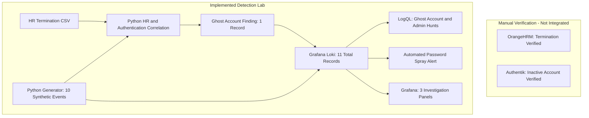
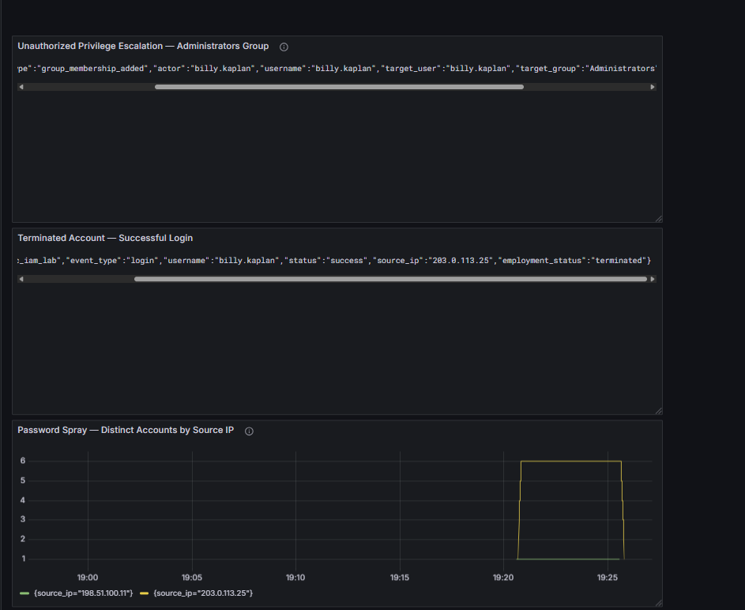
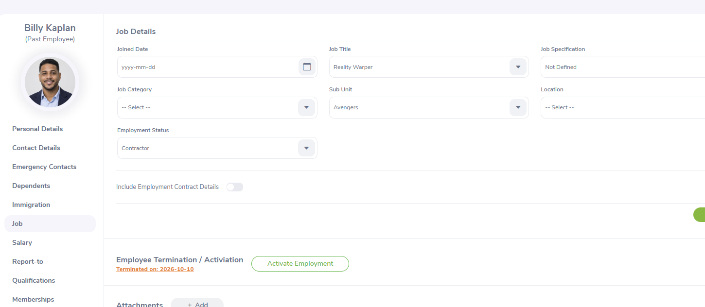
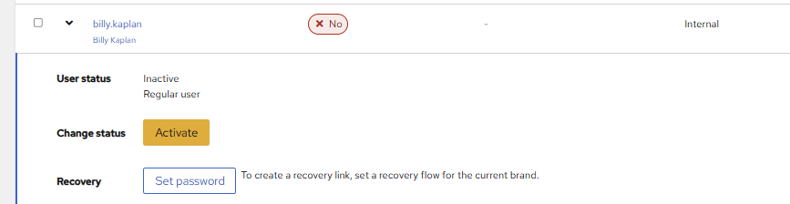
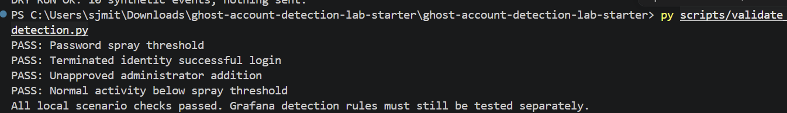
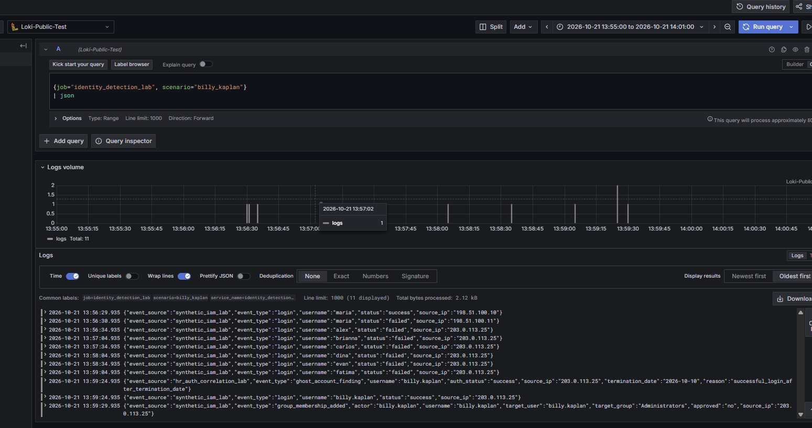
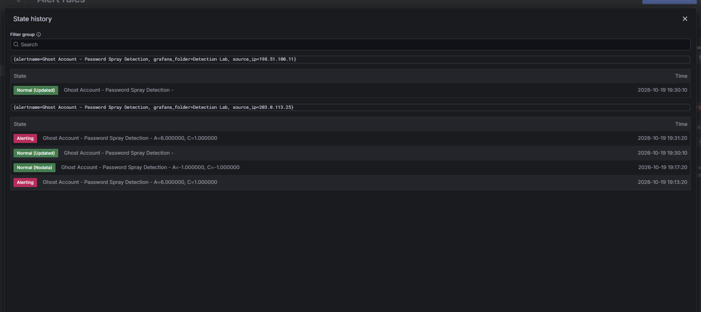

# The Ghost Account: Identity Threat Detection Lab

### The Employee Left. Their Access Didn't.

**Detecting password spraying, suspicious terminated-account authentication, and unauthorized privilege changes using Python, Grafana Loki, and LogQL.**

**Technologies:** Python 3 | OrangeHRM | Authentik | Grafana Loki | LogQL | Grafana

**Status:** Completed and validated — October 2026

---

## 1. The Problem — When Identity Controls Fail, Who Detects It?

Terminating an employee should trigger the immediate removal of access to corporate systems. However, compromised credentials, stale permissions, lingering sessions, and unauthorized privilege changes can expose organizations to continued identity-based threats.

Security teams need to detect three particularly concerning behaviors:

- **Password spraying:** Repeated authentication failures across multiple user accounts from a common source.
- **Terminated-account authentication:** Successful login activity associated with an identity that should no longer have access.
- **Unauthorized privilege escalation:** Elevated permissions granted without appropriate approval.

**Business Impact:** Without effective identity threat monitoring, unauthorized access attempts and privilege changes may remain undetected, increasing the risk of account compromise, data exposure, and lateral movement.

**The challenge:** Build a detection pipeline capable of identifying suspicious authentication patterns, distinguishing threats from ordinary login failures, and automatically alerting defenders when suspicious activity exceeds defined thresholds.

## 2. The Solution — An Identity Threat Detection Pipeline

I developed an identity threat detection workflow using Python, separate HR termination reference data, Grafana Loki, LogQL, and Grafana. The lab includes one automated password-spray alert and two manually executed investigation detections.

The solution delivers:

1. **Centralized security event ingestion** for structured authentication and privileged-access logs.
2. **Three detection queries** identifying password spraying, terminated-account login events, and unauthorized administrator assignments.
3. **A centralized Grafana dashboard** for investigating suspicious activity.
4. **Automated password-spray alerting** when five or more distinct accounts are targeted from the same source IP within five minutes.
5. **Validation testing** confirming suspicious behaviors are detected while normal login failures remain below the alert threshold.

The implementation combines IAM lifecycle context with security monitoring to demonstrate how identity risks can be identified through event analysis and automated detection.

## 3. How I Implemented the Solution

| Phase | Engineering Work |
|---|---|
| Identity Verification | Verified Billy Kaplan's termination record in OrangeHRM and inactive identity in Authentik |
| Event Generation | Generated 10 synthetic authentication and access-change events, then correlated independent HR termination data to produce 1 additional security finding (11 records total) |
| Log Ingestion | Submitted structured JSON events through Loki's HTTP ingestion API |
| Detection Logic | Developed LogQL queries targeting three identity threat patterns |
| Security Monitoring | Created a three-panel Grafana investigation dashboard |
| Automated Alerting | Configured a password-spray alert with a one-minute evaluation interval |
| Validation | Tested detection conditions, ingestion, query results, and alert state transitions |


### Security Detection Pipeline Architecture



**Architecture notes:** OrangeHRM and Authentik were manually inspected for identity context; neither is directly integrated with this synthetic event pipeline. A separate HR termination CSV is correlated with synthetic authentication events in Python. The lab generates 10 source events and 1 derived ghost-account finding, sends 11 records to Loki, and uses Grafana for investigations and password-spray alerting. Only the password-spray alert is automated.

## 4. Results — What the Solution Detected

The lab detected simulated suspicious activity, ingested 11 records into Loki, retrieved an HR-correlated ghost-account finding through Grafana, and demonstrated an automated password-spray alert. Ghost-account and administrator-change investigations remain manual queries.

| Detection / Validation | Verified Result |
|---|---|
| Password spraying | 6 distinct accounts targeted from one source IP |
| Normal failed authentication | 1 account from a separate IP, below the threshold |
| Terminated-account authentication | 1 matching synthetic successful-login event |
| Unauthorized privilege escalation | 1 matching synthetic administrator-group addition |
| Python validation | 5 of 5 local Python validation checks passed |
| Loki ingestion | HTTP 204 |
| Loki records accepted | 11 records (10 original synthetic events + 1 HR-correlated ghost-account finding) |
| Detection queries | 3 successfully tested |
| Grafana monitoring | 3 working investigation panels |
| Automated password-spray alert | Entered Firing / Alerting state |

### Security Detection Dashboard

I developed a three-panel Grafana dashboard to provide visibility into authentication failures, terminated-account login activity, and unauthorized privileged-group changes.



**Key Outcome:** The system identified six distinct accounts targeted by a simulated password spray, distinguished the suspicious pattern from isolated normal authentication failure, and automatically triggered a Grafana alert.

The terminated-account and privilege-change patterns were validated through LogQL investigation queries. Only the password-spray detection was configured and tested as an automatic alert.

## 5. Security Investigation — The Ghost Account

### Stage 1 — Employee Termination

Billy Kaplan's HR record documented termination on October 10, 2026.

An identity review confirmed that his corresponding Authentik account, `billy.kaplan`, was inactive.

This established the expected access-control baseline: a terminated identity should not have active system access.

### Stage 2 — Simulated Password Spraying

A controlled simulation generated failed authentication attempts against six different user accounts from the source IP:

`203.0.113.25`

The dataset also included one ordinary failed-login event from another source IP.

This created both a suspicious authentication pattern and a normal-activity comparison for validation.

### Stage 3 — Suspicious Terminated-Account Authentication

A synthetic security event recorded a successful login attributed to `billy.kaplan` while the event's employment status was marked as terminated.

This represented a hypothetical access-control failure requiring security investigation.

### Stage 4 — Unauthorized Privilege Change

A subsequent synthetic event recorded an unapproved addition of `billy.kaplan` to the Administrators group.

This modeled a potential privilege escalation following suspicious authentication activity.

### Stage 5 — Detection and Investigation

The synthetic security events were ingested into Loki and investigated using LogQL.

Grafana returned matching records for all three suspicious behaviors.

The password-spray alert automatically entered the Alerting/Firing state when the distinct-account threshold was exceeded.

**Investigation scope:** The suspicious authentication and privilege-change events were simulated. They were not actual actions performed against Billy's inactive Authentik account.

## 6. Detection Engineering — LogQL Implementation

### Detection 1 — Password Spraying

**Objective:** Identify multiple distinct accounts experiencing failed authentication from a common source IP within five minutes.

```logql
count by (source_ip) (
  sum by (source_ip, username) (
    count_over_time(
      {job="identity_detection_lab", scenario="billy_kaplan"}
      | json
      | event_type="login"
      | status="failed"
      [5m]
    ) > bool 0
  )
)
```

**Observed Result:**

- Suspicious IP: `203.0.113.25`
- Distinct accounts targeted: 6
- Detection window: 5 minutes
- Automated alert threshold: Greater than 4
- Result: Detection condition satisfied

The query counts distinct usernames rather than simply counting failed authentication events, helping distinguish a password-spray pattern from repeated attempts against a single account.

### Detection 2 — HR-Correlated Ghost Account Detection

**Objective:** Identify successful authentication events associated with terminated employees by correlating two separate data sources.

**Problem:** Authentication logs do not normally contain an employee's HR termination status. Relying on a prepopulated `employment_status` field would not demonstrate real correlation.

**Solution:** Developed a Python correlation process that independently reads HR termination reference data from `data/terminated_users.csv` and synthetic authentication events generated by `send_simulated_events.py`.

The correlation logic:

1. Loads terminated employee records from the HR reference file.
2. Matches authentication usernames against the terminated identities.
3. Compares successful login dates with termination dates.
4. Generates a `ghost_account_finding` when successful authentication occurs after termination.
5. Sends the enriched security finding to Grafana Loki for investigation.

**LogQL Investigation Query:**

```logql
{job="identity_detection_lab", scenario="billy_kaplan"}
| json
| event_type="ghost_account_finding"
```

**Verified Results:**

- 1 HR-correlated ghost-account finding generated for `billy.kaplan`.
- 3 correlation tests passed, including two negative scenarios.
- 11 synthetic events and findings accepted by Loki (HTTP 204).
- 1 matching ghost-account finding retrieved in Grafana Explore.

**Security Significance:** Demonstrates cross-source identity correlation without embedding HR employment status in the original authentication event.

**Scope:** The HR reference file and authentication events are lab data. The correlation logic was executed and its finding retrieved from Loki; live HR and identity-provider log integration was not implemented.

### Detection 3 — Unauthorized Privilege Escalation

**Objective:** Detect unapproved membership additions to the Administrators group.

```logql
{job="identity_detection_lab", scenario="billy_kaplan"}
| json
| event_type="group_membership_added"
| target_group="Administrators"
| approved="no"
```

**Observed Result:** One synthetic unapproved administrator-group membership addition associated with `billy.kaplan`.

Production implementations would require approval verification through authoritative access-request or change-management records.

## 7. Automated Alerting and Validation

I configured a Grafana-managed password-spray alert to evaluate authentication activity automatically.

### Alert Configuration

| Parameter | Configuration |
|---|---|
| Alert Name | Ghost Account - Password Spray Detection |
| Data Source | Grafana Loki |
| Evaluation Interval | 1 minute |
| Detection Window | 5 minutes |
| Threshold | More than 4 distinct accounts |
| Pending Period | 0 seconds |
| Recorded State | Alerting / Firing |

### Verified Alert Execution

```text
Alert: Ghost Account - Password Spray Detection

Source IP: 203.0.113.25
Distinct Accounts: 6
Threshold: > 4

Query Value: A=6.000000
Condition Result: C=1.000000

State: Alerting
```

Grafana recorded that the detection condition was satisfied.

Subsequent state-history entries also reflected transitions to normal states as the query's matching activity aged outside the evaluation window or the alert configuration was updated.

**Validation Result:** The alert rule successfully identified the simulated password-spraying pattern during automatic evaluation.

## 8. Technical Challenges and Lessons Learned

### Challenge 1 — Grafana Data Source Connectivity

During implementation, Grafana initially failed to query Loki because of a data source connection configuration issue.

I troubleshot the issue by separating ingestion verification from Grafana's query connection, checking Loki readiness, and confirming that event submission returned HTTP 204.

After establishing a working Grafana data source, the synthetic logs were successfully retrieved and analyzed.

**Lesson learned:** Successful log ingestion does not guarantee successful querying or alerting. Each stage of the monitoring pipeline must be validated independently.

### Challenge 2 — Differentiating Suspicious Activity From Normal Authentication Failures

A single failed login does not necessarily indicate an attack.

The password-spray detection used distinct-account aggregation to identify multiple accounts targeted by a common source IP within a defined time window.

**Lesson learned:** Effective detection engineering depends on meaningful aggregation, time windows, and thresholds—not just raw event counts.

### Challenge 3 — Validating Automated Alerts

A working LogQL query does not prove that an automated alert will trigger.

I configured the evaluation interval, threshold, pending period, and alert state handling, then generated fresh synthetic events to validate execution.

**Lesson learned:** Alert state history provides important evidence that detection rules are evaluated and can trigger under expected conditions.

### Challenge 4 — Connecting IAM With Security Detection

The HR termination record and inactive Authentik account established the expected identity lifecycle state.

The simulated security events demonstrated how a defender might investigate activity inconsistent with that state.

**Lesson learned:** Identity lifecycle context can strengthen authentication and privilege-change investigations.

## 9. Project Evidence

### Identity Lifecycle Verification

**Employee termination — OrangeHRM**



**Inactive identity — Authentik**



### Security Event Generation and Detection

**Python validation — Four passing checks**



**Synthetic events collected in Loki**



**Grafana investigation dashboard**


**Automated alert state history**



## 10. Reproducing the Detection Simulation

### Requirements

- Python 3
- Authorized Grafana Loki environment
- Grafana configured to query the Loki data source

### Generate Synthetic Events

```powershell
py scripts/send_simulated_events.py --dry-run
```

### Validate Detection Conditions

```powershell
py scripts/validate_detection.py
```

### Configure a Loki Ingestion Endpoint

```powershell
$env:LOKI_PUSH_URL = "http://YOUR-LOKI-HOST:PORT/loki/api/v1/push"
```

### Submit Synthetic Security Events

```powershell
py scripts/send_simulated_events.py --send
```

### Investigate Security Events

In Grafana Explore, run:

```logql
{job="identity_detection_lab", scenario="billy_kaplan"} | json
```

The `queries/` directory contains the saved detection queries and a proposed administrator-change alert query.

Only the password-spray alert was configured and validated as an automated Grafana alert.

## 11. Future Improvements

Potential improvements include:

- Correlating authoritative HR lifecycle events with live identity-provider authentication data.
- Implementing additional automated alerts for terminated-account access and unauthorized privilege changes.
- Developing Sigma rules for portable security detection logic.
- Enriching authentication events with additional user, device, and source context.
- Introducing alert severity classifications and incident response playbooks.
- Expanding validation coverage to include duplicate events, false positives, ingestion failures, and additional attack scenarios.

## 12. Security and Testing Scope

This project used controlled synthetic security events and documentation-only IP addresses.

Billy Kaplan's termination and inactive Authentik status were independently verified as identity lifecycle context. The suspicious login, password-spray activity, and privileged-group change were simulated using Python.

No actual unauthorized login, account compromise, privilege escalation, or real password-spray attack was performed.

Sensitive credentials and private infrastructure details are excluded from the repository.

---

## Project Outcome

**Built and validated an end-to-end identity threat detection pipeline using Python, Grafana Loki, LogQL, and Grafana.**

The implementation demonstrates hands-on experience in security event generation, centralized log ingestion, detection logic development, security investigations, Grafana dashboard configuration, automated alerting, troubleshooting, and validation.

By connecting IAM lifecycle context with security event analysis, the project demonstrates a practical approach to detecting identity-related threats and improving security monitoring visibility.


